# Elevate Digital

**A trilingual (Arabic / French / English, with full RTL) social-media-boosting storefront for Algerian e-commerce sellers, with three switchable themes including a signature "soap bubble" glassmorphism mode.** Next.js 16 front end, Express + MongoDB back end.


> Screenshots and GIFs are captured from the real app running locally (Next.js dev server + Express API + a MongoDB instance seeded with `backend/seed.js`).

## Highlights

- **Three languages, real RTL.** English, French and Arabic via `next-intl` with locale-prefixed routes (`/en`, `/fr`, `/ar`). Arabic flips the document to `dir="rtl"`, mirrors layout and icons, and works server-side (no flash).
- **Three themes.** White, Dark and Glass, switched from a custom dropdown and persisted in `localStorage`. Glass is the signature mode: translucent cards, backdrop blur and inset highlight/shadow pairs that make surfaces read like soap bubbles. Implemented as custom Tailwind 4 `@utility` classes (`.glassy`, `.input-bubbly`, `.mesh-gradient`).
- **Localized data from MongoDB.** Services and customer feedback are stored with per-language `name` / `description` fields and the UI picks the active locale.
- **Auth.** Register and login (email or username) against the Express API, passwords hashed with bcrypt, JWT issued on success, with an animated sliding Login / Register card.
- **Customer dashboard.** Glass sidebar layout with a greeting, balance / orders / active-boosts stat bubbles, recent orders and a quick-boost call to action.
- **Polished UI details.** Scroll-reveal sections and scroll-aware navbar (Framer Motion), custom `BubblySelect` dropdown replacing native selects, interactive focus scaling on inputs, responsive layout.

### Themes

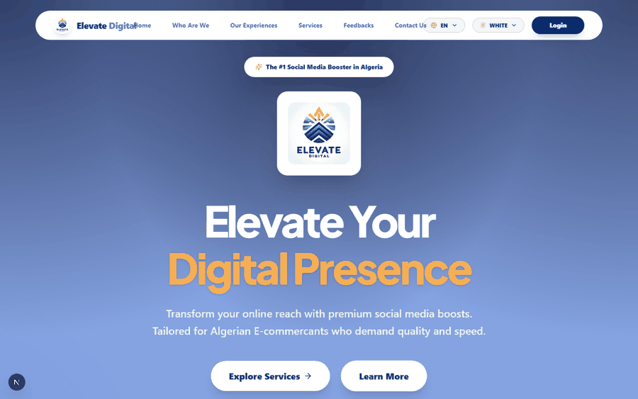

| White | Dark | Glass |
| --- | --- | --- |
| 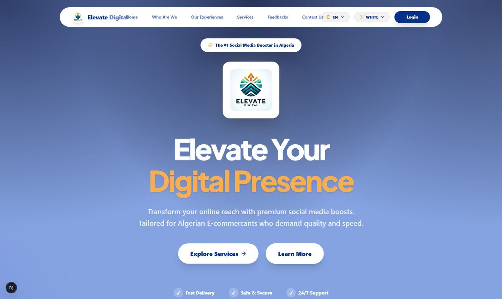 | 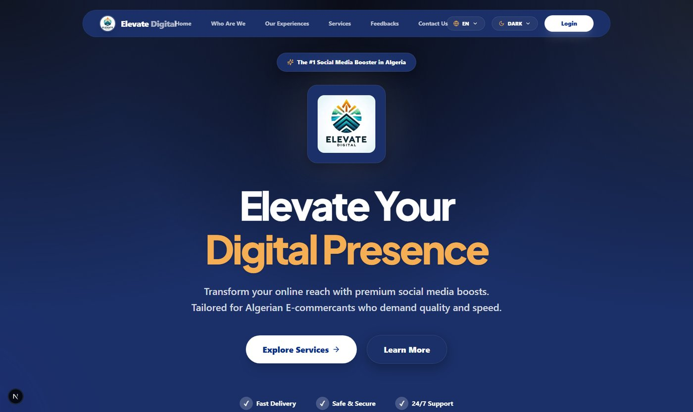 | 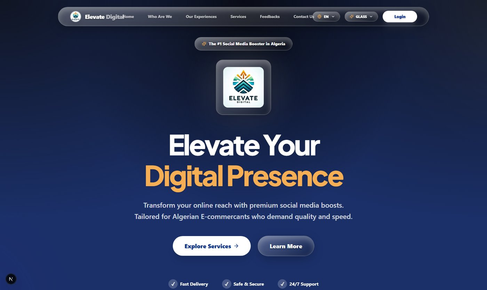 |

### Languages and RTL

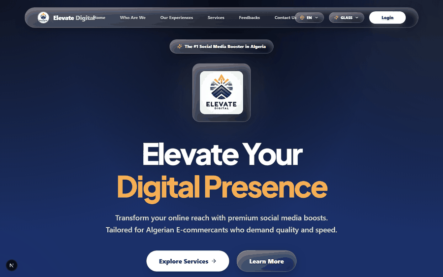

| English | Français | العربية (RTL) |
| --- | --- | --- |
|  | 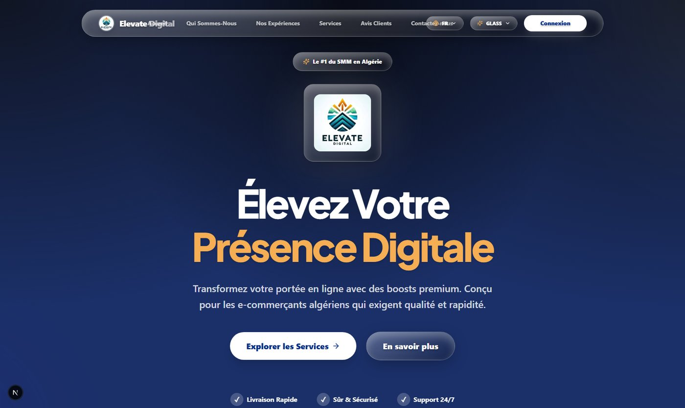 | 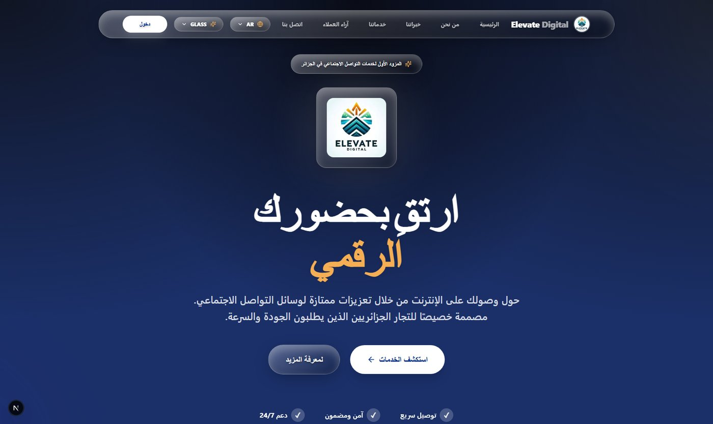 |

### Landing page, auth and dashboard

| Full landing page (Glass) | Full landing page (White) |
| --- | --- |
| 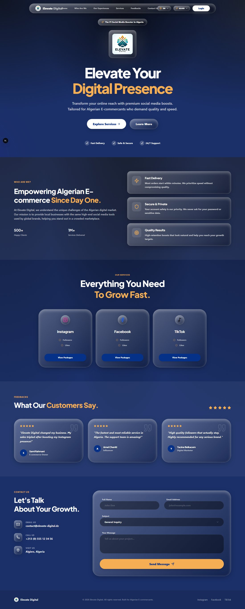 | 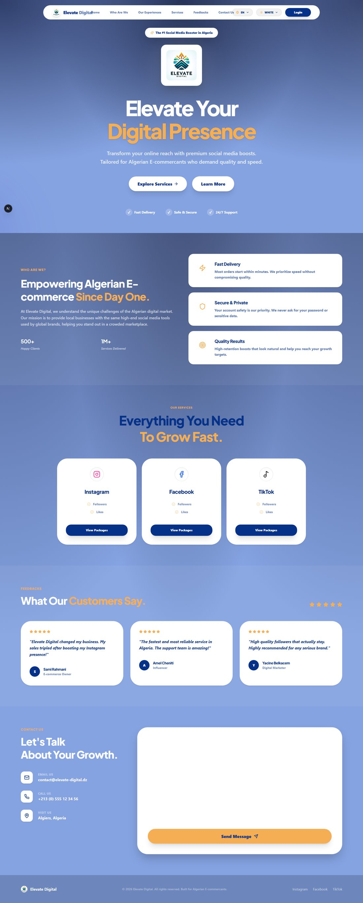 |

| Auth (Glass) | Auth (White) |
| --- | --- |
| 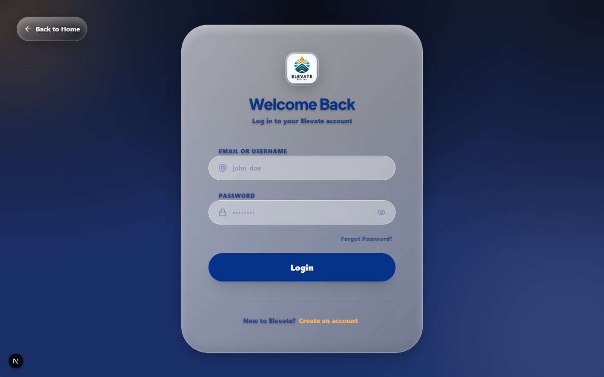 | 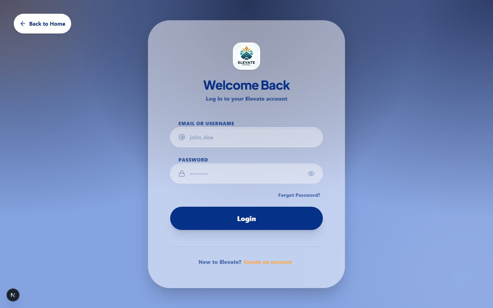 |

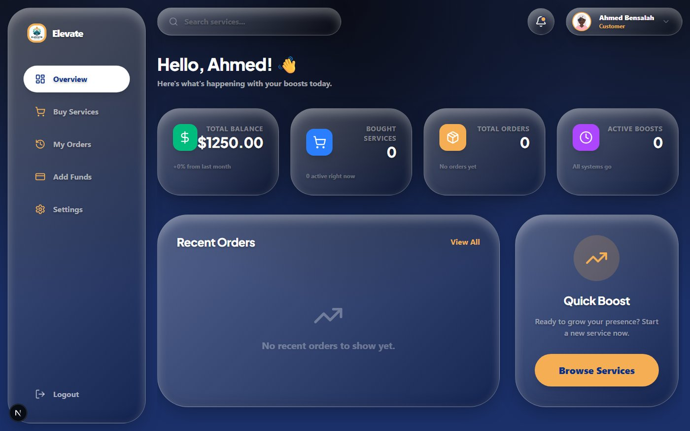

## Architecture

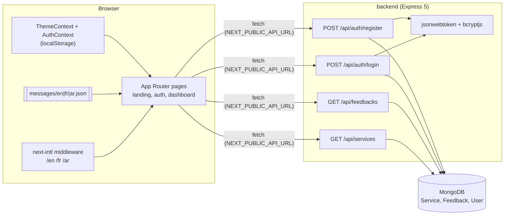

Localized content flows two ways: static UI strings live in `frontend/messages/*.json`, while services and feedbacks carry `{ en, fr, ar }` objects in MongoDB and are resolved client-side against the current locale.

## Tech stack

| Layer | Tools |
| --- | --- |
| Frontend | Next.js 16 (App Router), React 19, TypeScript, Tailwind CSS 4, Framer Motion, lucide-react, next-intl |
| Backend | Node.js, Express 5, Mongoose 9 (MongoDB), jsonwebtoken, bcryptjs, cors, dotenv |
| Fonts / design | Plus Jakarta Sans, custom Tailwind 4 utilities for the glass / soap-bubble look |

## Getting started

Prerequisites: Node 20+ and a MongoDB instance (local or Atlas).

```bash
# 1. API
cd backend
npm install
cp .env.example .env          # set MONGODB_URI and a long random JWT_SECRET
node seed.js                  # seeds services, feedbacks and a demo user
npm start                     # http://localhost:5000

# 2. Web (new terminal)
cd frontend
npm install
cp .env.example .env.local    # NEXT_PUBLIC_API_URL=http://localhost:5000/api
npm run dev                   # http://localhost:3000  (redirects to /en)
```

The seed creates a demo customer (`ahmed` / `password123`, local development only) so you can see the dashboard. Open `/fr` or `/ar` for the other locales.

API surface:

| Method | Route | Purpose |
| --- | --- | --- |
| GET | `/api/services` | Active services (localized names and descriptions) |
| GET | `/api/feedbacks` | Active customer feedback |
| POST | `/api/auth/register` | Create a customer account, returns JWT |
| POST | `/api/auth/login` | Login with email or username, returns JWT |

## Project structure

```
backend/
  index.js            Express app and routes
  models/             Service, Feedback, User (bcrypt hook) Mongoose models
  seed.js             Localized demo data
frontend/
  messages/           en.json, fr.json, ar.json
  src/
    middleware.ts     next-intl locale routing
    app/[locale]/     landing page, /auth, /dashboard
    components/       layout (Navbar, Hero, Services, Feedbacks, ContactUs...), dashboard, ui (BubblySelect)
    context/          ThemeContext, AuthContext
GEMINI.md             Design notes and UI principles used while building
```

## Status and roadmap

This is a front-end-first project; honest scope:

- **Built:** landing page, services and feedback from the API, i18n with RTL, three themes, register/login, dashboard overview.
- **Not built yet:** the other dashboard pages linked from the sidebar (Buy Services, My Orders, Add Funds, Settings), order placement, payments, an admin role UI, and API-side authorization middleware for protected routes. Dashboard stats are placeholders until orders exist.
- **Known polish items:** the glass navbar is tight on widths around 1440 px in English, and the contact form is not wired to a backend.

The repo keeps its real commit history (21 commits). Environment files that were committed during early development were scrubbed from the history before publishing; use your own `.env` values.

## Author

**Hannoun Amine Amar**, AI Engineer / Fullstack Developer, Algeria.
[LinkedIn](https://www.linkedin.com/in/hannoun-amine/) | hannoun.amine25@gmail.com

Licensed under the [MIT License](LICENSE).
