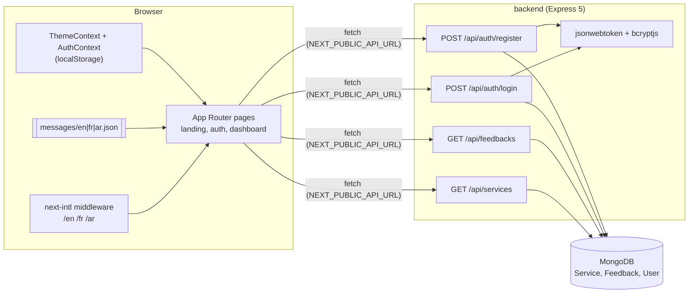

<p align="center">
  
</p>

<p align="center">
  
</p>

<p align="center">
  
  
  
  
  
  
  
  
  
</p>

<p align="center">
  
</p>

> Screenshots and GIFs are captured from the real app running locally (Next.js dev server + Express API + a MongoDB instance seeded with `backend/seed.js`).

## Table of contents

- [Overview](#-overview)
- [Features](#-features)
- [Demo and screenshots](#-demo-and-screenshots)
- [Architecture](#-architecture)
- [Tech stack](#-tech-stack)
- [Requirements](#-requirements)
- [Installation and configuration](#-installation-and-configuration)
- [Usage](#-usage)
- [Project structure](#-project-structure)
- [Testing](#-testing)
- [Troubleshooting and FAQ](#-troubleshooting-and-faq)
- [Roadmap](#-roadmap)
- [Contributing](#-contributing)
- [License](#-license)
- [Author](#-author)

## 🧭 Overview

**Problem.** Storefronts for social media boosting aimed at Algerian e-commerce sellers are rarely localized well: Arabic right-to-left support tends to be an afterthought.

**Solution.** Elevate Digital is a storefront with English, French and Arabic routes (real RTL, server-rendered), three switchable themes, and services and customer feedback loaded from a MongoDB-backed Express API. The signature Glass theme uses translucent, blurred surfaces with inset highlight/shadow pairs so cards read like soap bubbles.

## ✨ Features

- **Three languages, real RTL.** English, French and Arabic via `next-intl` with locale-prefixed routes (`/en`, `/fr`, `/ar`). Arabic flips the document to `dir="rtl"`, mirrors layout and icons, and works server-side (no flash).
- **Three themes.** White, Dark and Glass, switched from a custom dropdown and persisted in `localStorage`. Glass is the signature mode: translucent cards, backdrop blur and inset highlight/shadow pairs that make surfaces read like soap bubbles. Implemented as custom Tailwind 4 `@utility` classes (`.glassy`, `.input-bubbly`, `.mesh-gradient`).
- **Localized data from MongoDB.** Services and customer feedback are stored with per-language `name` / `description` fields and the UI picks the active locale.
- **Auth.** Register and login (email or username) against the Express API, passwords hashed with bcrypt, JWT issued on success, with an animated sliding Login / Register card.
- **Customer dashboard.** Glass sidebar layout with a greeting, balance / orders / active-boosts stat bubbles, recent orders and a quick-boost call to action.
- **Polished UI details.** Scroll-reveal sections and scroll-aware navbar (Framer Motion), custom `BubblySelect` dropdown replacing native selects, interactive focus scaling on inputs, responsive layout.

## 🎬 Demo and screenshots

### Themes


| White | Dark | Glass |
| --- | --- | --- |
|  |  |  |

### Languages and RTL


| English | Français | العربية (RTL) |
| --- | --- | --- |
|  |  |  |

### Landing page, auth and dashboard

| Full landing page (Glass) | Full landing page (White) |
| --- | --- |
|  |  |

| Auth (Glass) | Auth (White) |
| --- | --- |
|  |  |


## 🏗 Architecture



Localized content flows two ways: static UI strings live in `frontend/messages/*.json`, while services and feedbacks carry `{ en, fr, ar }` objects in MongoDB and are resolved client-side against the current locale.

## 🧰 Tech stack

| Layer | Tools |
| --- | --- |
| Frontend | Next.js 16 (App Router), React 19, TypeScript, Tailwind CSS 4, Framer Motion, lucide-react, next-intl |
| Backend | Node.js, Express 5, Mongoose 9 (MongoDB), jsonwebtoken, bcryptjs, cors, dotenv |
| Fonts / design | Plus Jakarta Sans, custom Tailwind 4 utilities for the glass / soap-bubble look |

## 📋 Requirements

| Item | Requirement |
| --- | --- |
| OS | Windows, macOS or Linux |
| Node.js | 20.9 or newer (required by Next.js 16), with npm |
| Database | MongoDB: a local instance (`mongodb://127.0.0.1:27017`) or a free [MongoDB Atlas](https://www.mongodb.com/atlas) cluster |
| Ports | `5000` (API, override with `PORT`), `3000` (web) |
| Hardware | No GPU or special hardware |
| Accounts / API keys | None, apart from a MongoDB Atlas account if you do not run MongoDB locally. You choose your own `JWT_SECRET` |

## ⚙ Installation and configuration

```bash
git clone https://github.com/ORD1STAR/elevate-digital.git
cd elevate-digital

# 1. API
cd backend
npm install
cp .env.example .env          # set MONGODB_URI and a long random JWT_SECRET
node seed.js                  # seeds services, feedbacks and a demo user
npm start                     # http://localhost:5000  (npm run dev for nodemon)

# 2. Web (new terminal, from the repo root)
cd frontend
npm install
cp .env.example .env.local    # NEXT_PUBLIC_API_URL=http://localhost:5000/api
npm run dev                   # http://localhost:3000  (redirects to /en)
```

### Environment variables

| File | Name | Required | Description | Example |
| --- | --- | --- | --- | --- |
| `backend/.env` | `MONGODB_URI` | yes | MongoDB connection string (local or Atlas) | `mongodb://127.0.0.1:27017/elevate-digital` |
| `backend/.env` | `JWT_SECRET` | yes | Secret used to sign login tokens (1 day expiry). Use a long random string | `YOUR_LONG_RANDOM_SECRET` |
| `backend/.env` | `PORT` | no | API port (default `5000`) | `5000` |
| `frontend/.env.local` | `NEXT_PUBLIC_API_URL` | no | API base URL (falls back to `http://localhost:5000/api`) | `http://localhost:5000/api` |

> Warning: `node seed.js` deletes all existing services, feedbacks and users before inserting the demo data. Do not run it against a database you care about.

## 🚀 Usage

1. Open `http://localhost:3000` (redirects to `/en`), or go to `/fr` or `/ar` for the other locales.
2. Log in on the auth page with the seeded demo customer (`ahmed` / `password123`, local development only) to see the dashboard, or register a new account.
3. Use the theme dropdown to switch between White, Dark and Glass.

API surface:

| Method | Route | Purpose |
| --- | --- | --- |
| GET | `/api/services` | Active services (localized names and descriptions) |
| GET | `/api/feedbacks` | Active customer feedback |
| POST | `/api/auth/register` | Create a customer account, returns JWT |
| POST | `/api/auth/login` | Login with email or username, returns JWT |

## 🗂 Project structure

<details>
<summary><b>Show tree</b></summary>

```
backend/
  index.js            Express app and routes
  models/             Service, Feedback, User (bcrypt hook) Mongoose models
  seed.js             Localized demo data
frontend/
  messages/           en.json, fr.json, ar.json
  src/
    middleware.ts     next-intl locale routing
    app/[locale]/     landing page, /auth, /dashboard
    components/       layout (Navbar, Hero, Services, Feedbacks, ContactUs...), dashboard, ui (BubblySelect)
    context/          ThemeContext, AuthContext
GEMINI.md             Design notes and UI principles used while building
```

</details>

## 🧪 Testing

There is no automated test suite yet (`backend` only has the default placeholder `test` script). Static checks available for the front end:

```bash
cd frontend
npm run lint
npm run build
```

## 🩺 Troubleshooting and FAQ

<details>
<summary><b>The page loads but services and feedback are empty</b></summary>

Make sure the API is running, `node seed.js` has been run, and `NEXT_PUBLIC_API_URL` in `frontend/.env.local` points to the API (restart `npm run dev` after changing it).

</details>

<details>
<summary><b>MongoDB connection error on API start</b></summary>

Check that `MONGODB_URI` in `backend/.env` is set and that MongoDB is reachable. For Atlas, allow your IP address in the cluster's network access list.

</details>

<details>
<summary><b>I cannot log in</b></summary>

Run `node seed.js` to create the demo user, or register a new account. Note that the seed script resets the users collection.

</details>

<details>
<summary><b>The API log says "Connected to MongoDB Atlas" while I use a local database</b></summary>

That is a static log message in `backend/index.js`; it prints for any successful connection.

</details>

## 🗺 Roadmap

- [x] Landing page with services and feedback from the API
- [x] i18n with real RTL (EN / FR / AR)
- [x] Three themes (White, Dark, Glass)
- [x] Register / login with JWT, dashboard overview
- [ ] Remaining dashboard pages (Buy Services, My Orders, Add Funds, Settings)
- [ ] Order placement and payments
- [ ] Admin role UI and API-side authorization middleware for protected routes
- [ ] Wire the contact form to a backend
- [ ] Tighten the glass navbar around 1440 px in English
- [ ] Automated tests

The repo keeps its real commit history (21 commits). Environment files that were committed during early development were scrubbed from the history before publishing; use your own `.env` values.

## 🤝 Contributing

Issues and pull requests are welcome. Please run `npm run lint` in `frontend/` before opening a PR.

## 📄 License

Released under the [MIT License](LICENSE).

## 👤 Author

<table>
  <tr>
    <td><b>Hannoun Amine Amar</b><br/>AI Engineer / Fullstack Developer, Algeria</td>
    <td>
      <a href="https://www.linkedin.com/in/hannoun-amine/"></a>
      <a href="mailto:hannoun.amine25@gmail.com"></a>
      <a href="https://github.com/ORD1STAR"></a>
    </td>
  </tr>
</table>

<p align="center">
  
</p>
